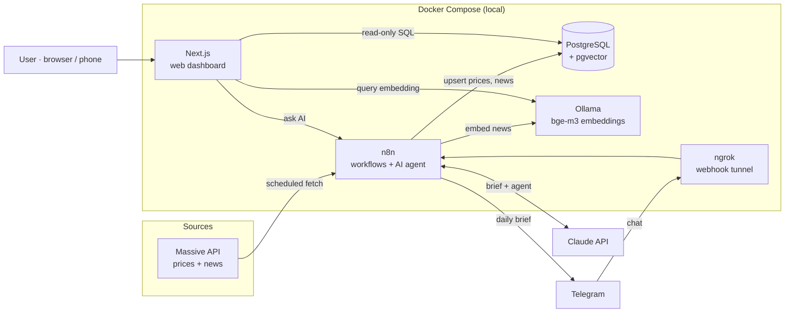

# 📈 Market Insights Agent

An automated, self-hosted AI agent that tracks a 40-stock US tech watchlist, collects daily prices and news, understands news by **meaning** (vector search), writes a daily market brief with **Claude**, and delivers it to **Telegram** and a **web dashboard**. It also answers questions about your portfolio from either.

> ระบบ AI ติดตามหุ้นเทคอเมริกา 40 ตัวแบบอัตโนมัติ ดึงราคาและข่าวทุกวัน ค้นข่าวด้วยความหมาย (ภาษาไทยก็ค้นข่าวภาษาอังกฤษเจอ) ให้ Claude เขียนสรุปตลาดส่งเข้า Telegram ทุกเย็น และมีเว็บแดชบอร์ดพร้อมช่องถาม AI · ทุกอย่างรันบนเครื่องตัวเองด้วย Docker


## ✨ Features

- **Automated data pipeline**: daily end-of-day prices for 40 stocks and market news every 6 hours, with automatic catch-up for missed days
- **Semantic news search**: news embedded locally with `bge-m3` (Ollama, GPU) and stored in **pgvector**; multilingual, so Thai queries find English articles
- **AI daily brief**: Claude summarizes market breadth, sector moves and top movers, citing only retrieved news (RAG) and saying so when no news explains a move
- **AI agent with tools**: Claude chooses its own tools (price history, stock news) to answer questions, reached from Telegram or the website
- **Web dashboard** (Next.js): market overview, sector heatmap, top movers, interactive price charts, news search and an "Ask AI" chat; installable as a PWA on mobile
- **Self-hosted**: one `docker compose up -d` starts all five services

| Stock page | Semantic news search | Ask AI |
|---|---|---|
|  |  |  |

## 🏗️ Architecture



### Scheduled workflows (n8n)

| Time (Asia/Bangkok) | Workflow | What it does |
|---|---|---|
| Daily 19:00 | Fetch Prices | Finds missing trading days, fetches grouped daily bars, upserts 40 stocks |
| Every 6 h | Fetch News | Pulls recent market news, keeps articles tagged with watchlist tickers |
| Every 6 h (:30) | Embed News | Embeds new articles with `bge-m3` into pgvector |
| Daily 19:30 | Daily Brief | Builds context (breadth, sectors, movers + news), Claude writes a brief, saves it and sends it to Telegram; skips days with no new market data |
| On message | Telegram Agent / Web Agent | Claude agent with SQL tools for prices and news |

## 🧰 Tech stack

| Area | Tools |
|---|---|
| Infrastructure | Docker Compose, WSL2, ngrok, Tailscale |
| Data | PostgreSQL 16, pgvector (HNSW, cosine distance), SQL (CTEs, window functions, upserts) |
| AI | Claude (Haiku) via n8n AI Agent, Ollama `bge-m3` embeddings, RAG |
| Automation | n8n (schedules, webhooks, retries, batching) |
| Web | Next.js 16 (App Router, Server Components, Route Handlers), React 19, TypeScript, Tailwind CSS v4, TradingView Lightweight Charts |

## 🗂️ Project structure

```
.
├── docker-compose.yml     # all 5 services
├── init/                  # database setup (runs on first start)
│   ├── 01-init.sql        #   app database + pgvector
│   ├── 02-schema.sql      #   tables, keys, indexes
│   └── 03-seed-stocks.sql #   40-stock watchlist
├── n8n-workflows/         # exported n8n workflows (JSON)
├── scripts/backup.ps1     # database backup + workflow export
└── web/                   # Next.js dashboard (own Dockerfile)
    ├── app/               #   pages, API route, PWA manifest/icon
    ├── components/        #   PriceChart, AskBox
    └── lib/               #   db pool, SQL queries, embeddings
```

## 🗄️ Data model

`stocks` · `daily_prices` (PK stock + date, upserted) · `news_articles` (unique URL) · `news_stocks` (many-to-many) · `news_embeddings` (`vector(1024)`, HNSW index) · `ai_reports` (one brief per day)

## 🚀 Running it

Requirements: Docker Desktop (with an NVIDIA GPU for Ollama, or remove the `deploy` block to use CPU), and API keys for Massive, Anthropic and a Telegram bot.

```bash
cp .env.example .env          # fill in your own values
docker compose up -d --build
docker compose exec ollama ollama pull bge-m3
```

Then open n8n at `http://localhost:5678`, create the credentials (Postgres, Massive, Claude, Telegram), import the files in `n8n-workflows/`, replace `YOUR_TELEGRAM_CHAT_ID` with your chat ID, and publish the workflows. The dashboard runs at `http://localhost:3000`.

## 🔒 Security notes

- All ports bind to `127.0.0.1`; only the n8n webhook is exposed through ngrok
- The website uses a **read-only** database role (`SELECT` only, no access to the n8n database)
- The web-to-n8n webhook requires a shared secret header, kept server-side in a Next.js Route Handler
- The Telegram agent only answers the owner's chat ID
- Secrets live in `.env` (git-ignored); exported workflows contain no credentials and the chat ID is masked

## 📚 What I learned

Building this end to end covered Docker networking and volumes, relational and vector database design, ETL with idempotent upserts, data-quality issues (such as a reused ticker symbol), embeddings and RAG, prompt and context engineering, tool-using AI agents, and a full Next.js app from server components to a containerized production build. One lesson stood out: when an AI agent explains its own behavior, check the execution logs.

---

*Not investment advice. Market data is end-of-day and for personal learning.*
