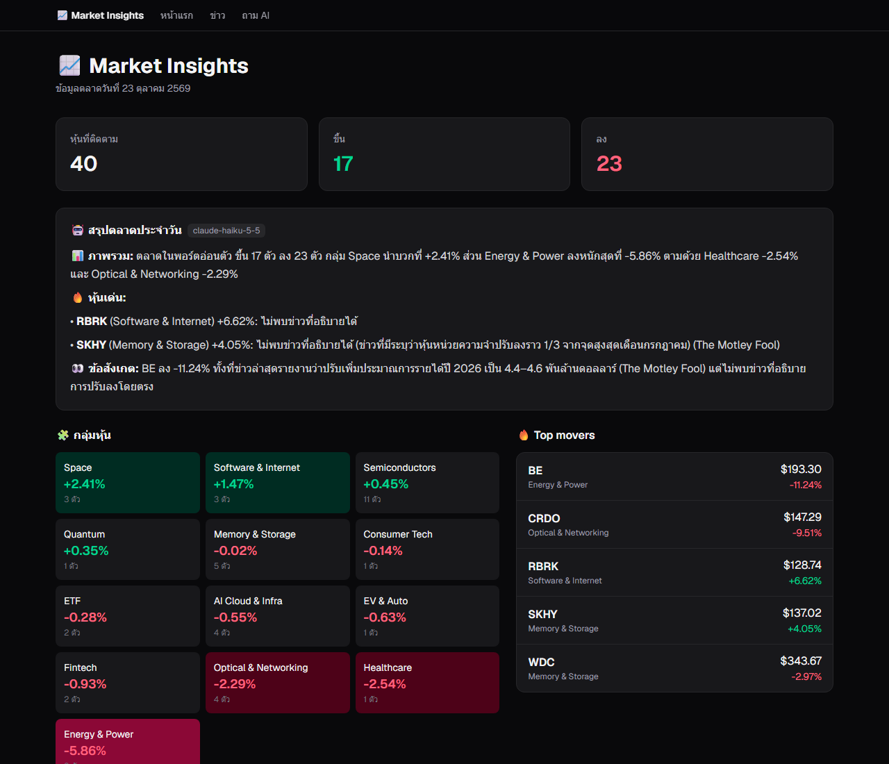
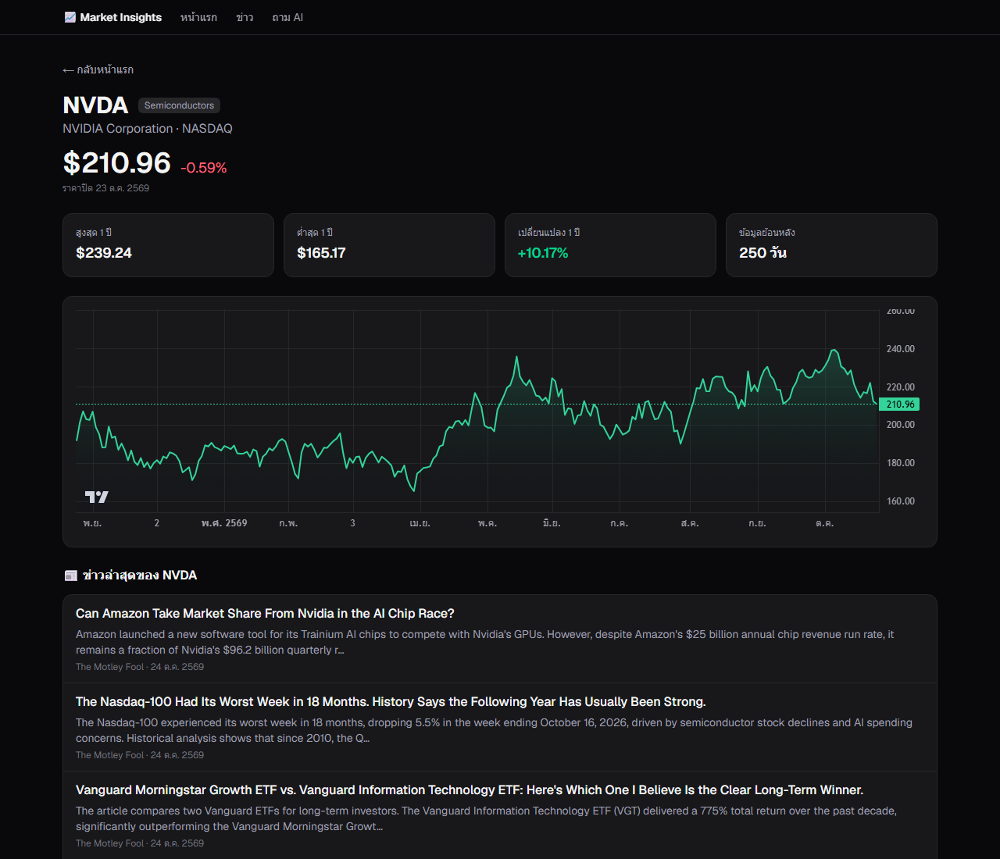
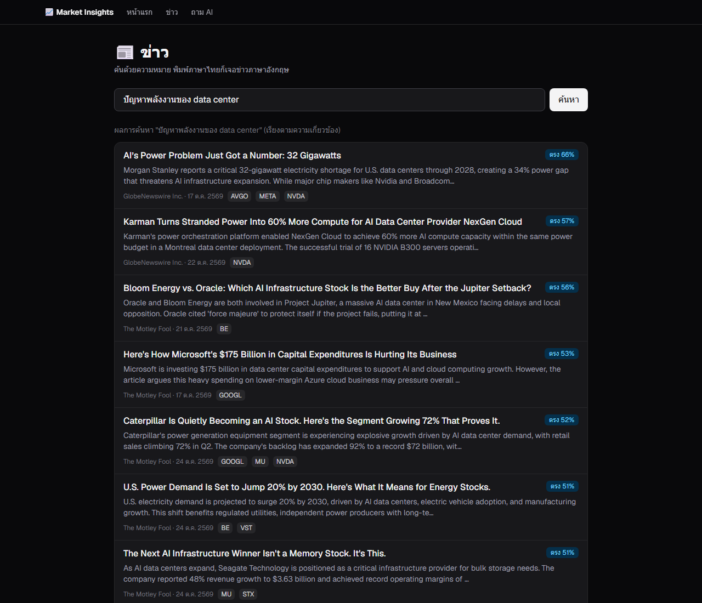
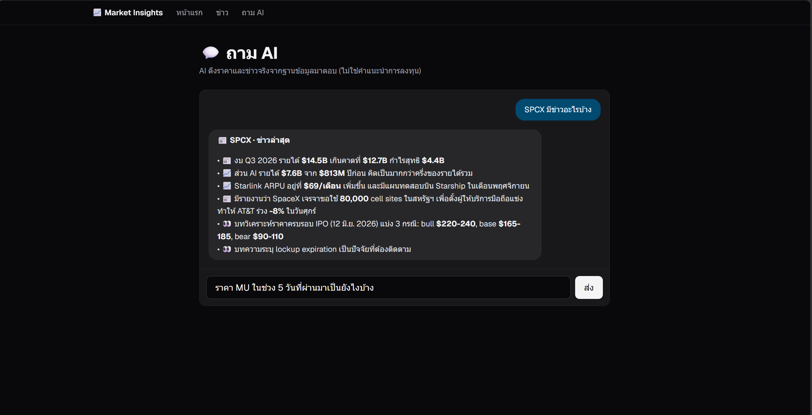
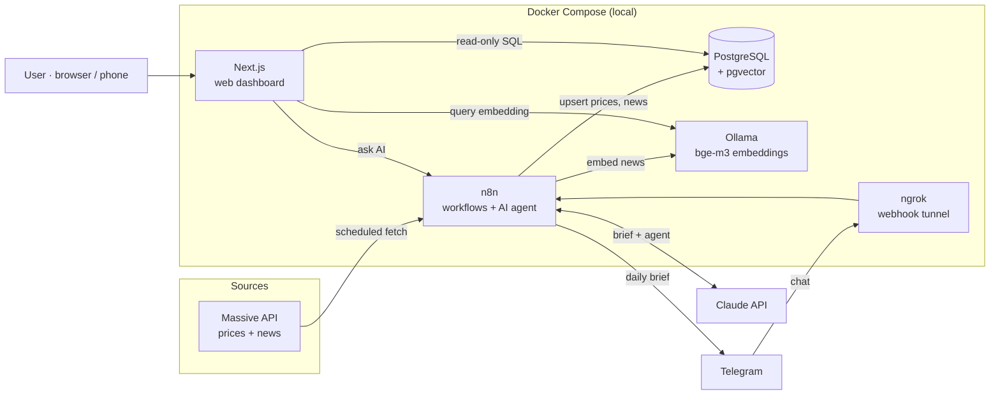

# 📈 Market Insights Agent

ระบบ **AI Agent** ที่รันบนเครื่องตัวเอง (self-hosted) คอยติดตามหุ้นเทคอเมริกา 40 ตัวแบบอัตโนมัติ ดึงราคาและข่าวทุกวัน เข้าใจข่าวด้วย **ความหมาย** (vector search) ให้ **Claude** เขียนสรุปตลาดประจำวัน แล้วส่งเข้า **Telegram** และแสดงบน **เว็บแดชบอร์ด** และยังถามคำถามเกี่ยวกับหุ้นในพอร์ตได้จากทั้งสองช่องทาง



## ✨ Features

- **Automated data pipeline**: ดึงราคาปิดรายวันของหุ้น 40 ตัว และข่าวตลาดทุก 6 ชั่วโมง ถ้าคอมปิดไปหลายวัน ระบบจะตามเก็บวันที่ขาดให้เอง
- **Semantic news search**: แปลงข่าวเป็นเวกเตอร์ด้วย `bge-m3` (Ollama บนการ์ดจอ) แล้วเก็บใน **pgvector** รองรับหลายภาษา พิมพ์ค้นเป็นภาษาไทยก็เจอข่าวภาษาอังกฤษ
- **AI daily brief**: Claude สรุปภาพรวมตลาด กลุ่มหุ้น และหุ้นที่ขยับแรง โดยอ้างอิงเฉพาะข่าวที่ค้นมาได้ (RAG) และบอกตรงๆ เมื่อไม่มีข่าวอธิบายการขยับของหุ้นตัวนั้น
- **AI agent with tools**: Claude เลือกใช้เครื่องมือเอง (ดึงประวัติราคา, ดึงข่าว) เพื่อตอบคำถาม ใช้งานได้ทั้งใน Telegram และบนเว็บ
- **Web dashboard** (Next.js): ภาพรวมตลาด, กลุ่มหุ้นไล่สี, Top movers, กราฟราคาแบบโต้ตอบได้, ค้นข่าว และหน้าแชท "ถาม AI" ติดตั้งเป็นแอปบนมือถือได้ (PWA)
- **Self-hosted**: สั่ง `docker compose up -d` คำสั่งเดียว เปิดครบทั้ง 5 service

| Stock page | Semantic news search | Ask AI |
|---|---|---|
|  |  |  |

## 🏗️ Architecture



### Scheduled workflows (n8n)

| เวลา (Asia/Bangkok) | Workflow | ทำอะไร |
|---|---|---|
| ทุกวัน 19:00 | Fetch Prices | หาวันทำการที่ยังไม่มีราคา แล้วดึงราคาของวันนั้น (grouped daily) มา upsert ครบ 40 ตัว |
| ทุก 6 ชม. | Fetch News | ดึงข่าวตลาดล่าสุด เก็บเฉพาะข่าวที่เกี่ยวกับหุ้นใน watchlist |
| ทุก 6 ชม. (นาทีที่ 30) | Embed News | แปลงข่าวใหม่เป็นเวกเตอร์ด้วย `bge-m3` แล้วเก็บลง pgvector |
| ทุกวัน 19:30 | Daily Brief | เตรียมข้อมูล (ตลาดขึ้น/ลง, กลุ่มหุ้น, หุ้นที่ขยับแรง + ข่าว) ให้ Claude เขียนสรุป บันทึกลงฐานข้อมูล และส่งเข้า Telegram (ถ้าไม่มีข้อมูลตลาดใหม่จะข้ามวันนั้น) |
| เมื่อมีข้อความเข้า | Telegram Agent / Web Agent | Claude agent ที่มีเครื่องมือ SQL สำหรับดึงราคาและข่าว |

## 🧰 Tech stack

| Area | Tools |
|---|---|
| Infrastructure | Docker Compose, WSL2, ngrok, Tailscale |
| Data | PostgreSQL 16, pgvector (HNSW, cosine distance), SQL (CTEs, window functions, upserts) |
| AI | Claude (Haiku) via n8n AI Agent, Ollama `bge-m3` embeddings, RAG |
| Automation | n8n (schedules, webhooks, retries, batching) |
| Web | Next.js 16 (App Router, Server Components, Route Handlers), React 19, TypeScript, Tailwind CSS v4, TradingView Lightweight Charts |

## 🗂️ Project structure

```
.
├── docker-compose.yml     # service ทั้ง 5 ตัว
├── init/                  # ตั้งค่าฐานข้อมูล (รันตอนเปิดครั้งแรก)
│   ├── 01-init.sql        #   สร้างฐานข้อมูลของแอป + เปิดใช้ pgvector
│   ├── 02-schema.sql      #   ตาราง, keys, indexes
│   └── 03-seed-stocks.sql #   รายชื่อหุ้น 40 ตัว (watchlist)
├── n8n-workflows/         # workflow ของ n8n ที่ export ไว้ (JSON)
├── scripts/backup.ps1     # สำรองฐานข้อมูล + export workflow
└── web/                   # เว็บแดชบอร์ด Next.js (มี Dockerfile ของตัวเอง)
    ├── app/               #   หน้าเว็บ, API route, PWA manifest/icon
    ├── components/        #   PriceChart, AskBox
    └── lib/               #   การเชื่อมต่อฐานข้อมูล, SQL queries, embeddings
```

## 🗄️ Data model

`stocks` · `daily_prices` (PK หุ้น + วันที่, upsert) · `news_articles` (URL ไม่ซ้ำ) · `news_stocks` (many-to-many ข่าว ↔ หุ้น) · `news_embeddings` (`vector(1024)`, HNSW index) · `ai_reports` (สรุป 1 ฉบับต่อวัน)

## 🚀 Running it

สิ่งที่ต้องมี: Docker Desktop (ใช้การ์ดจอ NVIDIA สำหรับ Ollama หรือลบบล็อก `deploy` ออกเพื่อใช้ CPU แทน) และ API key ของ Massive, Anthropic และบอท Telegram

```bash
cp .env.example .env          # ใส่ค่าของตัวเอง
docker compose up -d --build
docker compose exec ollama ollama pull bge-m3
```

จากนั้นเปิด n8n ที่ `http://localhost:5678` สร้าง credentials (Postgres, Massive, Claude, Telegram) แล้ว import ไฟล์ในโฟลเดอร์ `n8n-workflows/` เปลี่ยน `YOUR_TELEGRAM_CHAT_ID` เป็น Chat ID ของตัวเอง แล้วกด Publish ทุก workflow ส่วนเว็บแดชบอร์ดเปิดได้ที่ `http://localhost:3000`

## 🔒 Security notes

- ทุก port ผูกไว้ที่ `127.0.0.1` (เข้าได้เฉพาะเครื่องตัวเอง) มีเพียง webhook ของ n8n ที่เปิดออกภายนอกผ่าน ngrok
- เว็บใช้ user ฐานข้อมูลแบบ **อ่านอย่างเดียว** (`SELECT` เท่านั้น และเข้าฐานข้อมูลของ n8n ไม่ได้)
- webhook ระหว่างเว็บกับ n8n ต้องแนบรหัสลับ (secret header) ซึ่งเก็บไว้ฝั่งเซิร์ฟเวอร์ใน Next.js Route Handler เบราว์เซอร์มองไม่เห็น
- Telegram agent ตอบเฉพาะ Chat ID ของเจ้าของเท่านั้น
- ค่าลับทั้งหมดอยู่ใน `.env` (ไม่ขึ้น Git) ส่วน workflow ที่ export ไว้ไม่มี credentials และปิดบัง Chat ID แล้ว

## 📚 What I learned

การสร้างโปรเจกต์นี้ตั้งแต่ต้นจนจบทำให้ได้เรียนรู้ Docker networking และ volumes, การออกแบบฐานข้อมูลทั้งแบบ relational และ vector, การทำ ETL ด้วย upsert ที่รันซ้ำได้ (idempotent), ปัญหาคุณภาพข้อมูลที่เจอ (เช่น ticker ที่ถูกนำกลับมาใช้ใหม่), embeddings และ RAG, prompt engineering และ context engineering, AI agent ที่เลือกใช้เครื่องมือเอง ไปจนถึงการสร้างเว็บ Next.js เต็มรูปแบบตั้งแต่ server components จนถึงการ build เป็น container สำหรับใช้งานจริง บทเรียนที่ชัดที่สุดคือ เมื่อ AI agent อธิบายพฤติกรรมของตัวเอง ให้เช็คจาก execution logs เสมอ

---

*ไม่ใช่คำแนะนำการลงทุน ข้อมูลตลาดเป็นราคาปิดสิ้นวัน และจัดทำเพื่อการเรียนรู้ส่วนตัว*
